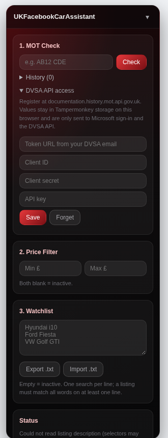

# UKFacebookCarAssistant



A Tampermonkey userscript that adds a floating research widget to Facebook Marketplace to speed up buying a car. It runs client-side with no server and no cost. The only network calls are the optional DVSA MOT History lookups, made with your own free API credentials.

## Features

1. **MOT Check** - on a listing page it spots UK registrations in the text (current `AB12 CDE`, prefix `P123 ABC` and suffix `ABC123D` styles) and offers each one as a button, or you can type a plate in. With DVSA access saved, the full MOT history is shown in the widget: make, model, colour, fuel, recalls, MOT status, and every test with mileage and defects. It warns when the MOT has expired, a recall is outstanding, the mileage went down between tests, the listing's mileage is lower than the last MOT reading, the latest test had dangerous defects, or there is a gap of over 14 months between tests. Without DVSA access it opens the official [check-mot.service.gov.uk](https://www.check-mot.service.gov.uk) results page in a new tab instead. Keeps a capped history of the last 20 checks, stored locally, each one a clickable link.
2. **Price Filter** - set a min and/or max price and matching listings on the search grid are hidden. Leave both blank to disable.
3. **Watchlist** - a list of searches (one per line, e.g. `Hyundai i10`), each matching a listing title if it contains all the words on that line, in any order. Import/export as `.txt`. Leave empty to disable.
4. **Time-Waster Scoring** - on an individual listing page, the description is checked for red flags (no firm price, scam phrasing, missing mileage/MOT/service history mentions). Two or more flags collapses the listing behind a warning banner you can expand.

## Install

1. Install [Tampermonkey](https://www.tampermonkey.net/) in your browser.
2. Open `car-buying-assistant.user.js` and let Tampermonkey pick it up, or paste its contents into a new script.
3. Visit `facebook.com/marketplace` - the widget appears floating in the top right and can be dragged or collapsed.

## DVSA API access (optional)

The [MOT History API](https://documentation.history.mot.api.gov.uk/) is free but needs your own credentials:

1. Register at <https://documentation.history.mot.api.gov.uk/mot-history-api/register>.
2. DVSA emails you a **client ID**, **client secret**, **API key** and a **token URL**
   (`https://login.microsoftonline.com/<tenant>/oauth2/v2.0/token`).
3. Open **DVSA API access** under the MOT Check section, paste all four in and press **Save**.

The client secret expires; DVSA's docs explain how to request a new one. Until access is saved, MOT Check keeps opening the gov.uk page.

## Known limitations

- Facebook Marketplace has no stable class names, so listing selectors target structural patterns (e.g. anchors linking to `/marketplace/item/`) and will need maintenance if Facebook changes its markup.
- Time-waster scoring only runs on individual listing pages, never on the search grid, because Facebook doesn't expose full descriptions in bulk.
- The watchlist is 100% local - it only matches what you've typed in yourself, not a full specs lookup.
- Plate spotting needs the seller to have written the registration somewhere, and can suggest false matches (e.g. "V8 GTI" looks like a prefix plate); nothing is looked up until you press one.

## Storage and privacy

- MOT history, watchlist, filter settings and DVSA credentials are stored locally via Tampermonkey's `GM_setValue`/`GM_getValue`.
- The client secret and API key are never shown again after saving; leave those boxes blank to keep the saved values, or press **Forget** to remove them.
- With DVSA access saved, the script only talks to `login.microsoftonline.com` (for a 1-hour access token, kept in memory) and `history.mot.api.gov.uk`. It refuses a token URL that isn't a Microsoft sign-in address, so the secret can't be sent anywhere else by mistake.
- Lookups are cached in memory for the page session, and only happen when you press a button. DVSA allows 500,000 lookups a day and 10 a second.
- Nothing else leaves your browser.

## Tests

The plate, mileage and MOT logic runs under Node without a browser:

```
npm test
```
